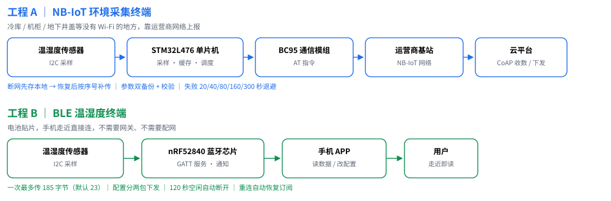

# 物联网终端固件｜两套可编译、可测试、可烧录的工程

**在线图文作品集**（概览 / 技术细节两档，手机可直接看）→ https://zzdxkk.github.io/iot-terminal-portfolio/

独立完成：需求拆解 → 硬件抽象层（把芯片寄存器操作收在一层接口后面） → 驱动与协议 → 状态机与缓存 → 单元测试 → 交叉编译出可烧录固件。
**91 项断言全通过，两套固件可直接烧录（.hex / .bin）。**



## 两个工程，解决的是两类现场问题

| | **工程 A：NB-IoT 环境采集终端** | **工程 B：BLE 温湿度终端** |
|---|---|---|
| 场景 | 冷库、机柜、地下井盖——没有 Wi-Fi、不方便布线 | 电池供电的贴片，手机走近直接读 |
| 芯片 | STM32L476 + BC95 模组（AT 指令） | nRF52840 + S140 协议栈 |
| 固件 | 62 KB，Flash 占 5.98%，RAM 占 3.16% | 23 KB，Flash 占 2.64%，RAM 占 2.77% |
| 核心难点 | 弱信号重试退避、断网不丢数据、掉电不丢参数、看门狗 | MTU 协商与配置分包、订阅状态、空闲断开与重连恢复 |
| 验证 | 61 项断言 + 3 小时整机仿真（含断网、掉线、补传剧本） | 30 项断言 + 5 分钟全链路仿真（广播→连接→协商→订阅→通知→重连） |

两套工程共用同一套代码组织方式：`src/` 放业务逻辑、`target/` 放真机实现、`sim/` 放假硬件——**同一份业务代码，既能在电脑上跑仿真，也能编译成芯片固件**，这是我最想让人看到的一点。

## 一条命令复现全部结果

```bash
./build_all.sh     # 两套 PC 单元测试 + 两套仿真 + 两套 ARM 交叉编译
```

真实终端输出：

```
==== NB-IoT ====
========== 结果：61 通过 / 0 失败 ==========
[结论] 采样=359 上行成功=21 失败=0 缓存=2 补传成功=2 平台配置生效=1 周期=600s

==== BLE ====
========== 结果：30 通过 / 0 失败 ==========
[结论] 采样=30 通知=3 配置更新=1 连接=2 断开=2 空闲断开=1 周期=120s MTU=185
```

## 边界（说清楚，不夸大）

- 已到「**可编译、可测试、可烧录固件**」这一层；交叉编译通过 ≠ 上板验证。
- 没有开发板与 J-Link：**实机时序、无线互通、整机电流均未实测**。
- 两套工程各附 8 项产测清单，上板后按清单逐项执行即可。
- CoAP 为自研子集（RFC 7252 常用部分）；BLE 单连接、无绑定配对；OTA 未启用（S140 + bootloader 会占约 1/4 Flash）。

## 仓库结构

```
index.html                  在线作品集页面（概览 + 技术细节）
qr.svg                      指向本作品集的二维码
assets/architecture.svg     两套终端的链路图
nbiot-env-terminal/         工程 A 源码（CMake：PC 目标 + ARM 目标）
ble-sensor-terminal/        工程 B 源码
firmware/                   交叉编译产物：*.hex / *.bin / *.map
```

---

扫码在手机上看：


